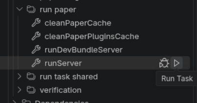

# How to start the OpenMC server locally?
### **Information**: This tutorial is currently based on Visual Studio Code and was written on a computer running a Linux operating system. It is possible that the different methods for achieving the result might not work. In that case, go ask on the [Discord](discord.openmc.fr) to see if people can help you.

### Throughout this tutorial, there will be two working methods: a **simple** one (Solution 1) and a **"hard" one for beginners** (Solution 2). 

### Step 1:
**Solution 1:**

Install the VSCode extension: [Gradle for Java](https://marketplace.visualstudio.com/items?itemName=vscjava.vscode-gradle)

Optional but recommended extensions: [Language Support for Java(TM) by Red Hat](https://marketplace.visualstudio.com/items?itemName=redhat.java); [Extension Pack for Java](https://marketplace.visualstudio.com/items?itemName=vscjava.vscode-java-pack)

**Solution 2:**
If you do not want to use an extension, skip to step 2.

### Step 2:
**Solution 1:**
Look in the sidebar for a sort of elephant icon (or the Gradle extension directly if you know the logo)


Next, go to the Tasks section; then to the Run Paper section. You will see that four options are available to you.

- cleanPaperCache (allows you to delete the generated cache **except** the plugins cache)
- cleanPaperPluginsCache (allows you to delete the generated plugins cache)
- runDevBundleServer (I don't know, but apparently it's to launch a server and test it (not relevant in our case))
- runServer (start the server)

The last one is of particular interest to us; it allows you to launch the server. So to start it, hover over it and click on Run Task.



**Solution 2:**

Open a command terminal in the root directory of the project and run this:

``` ./gradlew runServer ```

Note from ElectroLynx: I don't recommend this because you will have to configure the Java version and fix small issues everywhere for it to work. Therefore, I recommend this technique for those who want to have full control over what they are doing.

### Step 3
**Solution 1 and 2:**
 Open Minecraft in 26.3 and connect to the server: 
 ``` localhost:25565 ```

 From then on, you will be on your local OpenMC instance!

 ## Startup troubles and bugs
| Error | Reason | How to solve it |
|---|---|---|
|Unrecognized VM option | An argument that Java does not recognize | Go to [build.gradle](../build.gradle#L162)
|This list can be improved | Contribute to it | [Contribute on GitHub](https://github.com/ServerOpenMC/Plugin-V2)