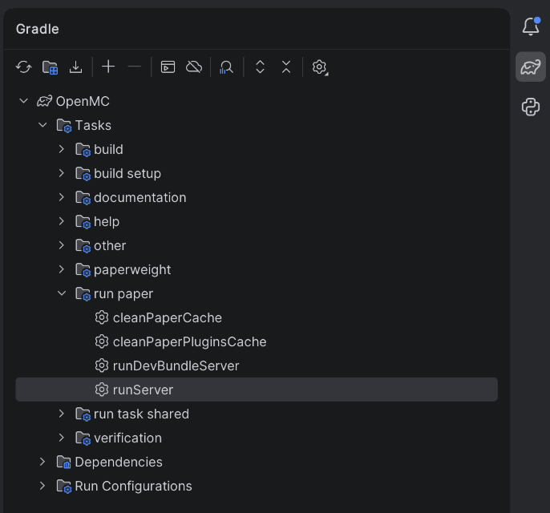
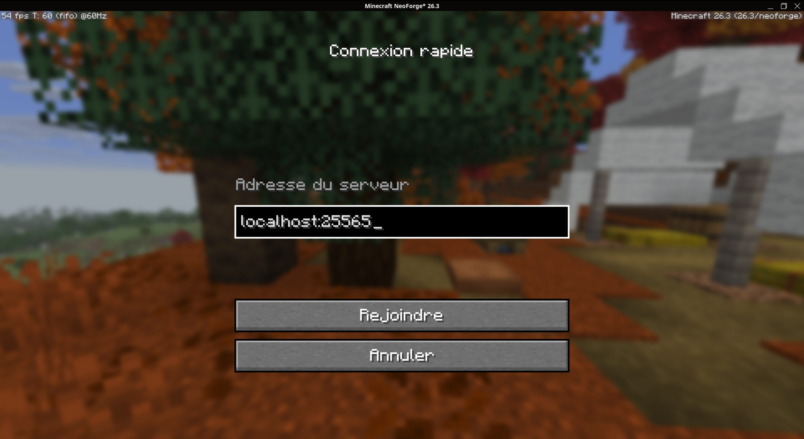

# Comment démarrer le serveur OpenMC en local ?
<<<<<<< HEAD
### **Information** : Ce tutoriel se base sur Visual Studio Code actuellement et a été écrite sur un ordinateur avec un système d'exploitation Linux. Il se peut que les différentes moyens d'avoir le résultat ne fonctionnent pas. Dans ce cas aller demander sur le [Discord](discord.openmc.fr) si des gens peuvent vous aider.
=======
### **Information** : Ce tutoriel se base sur IntelliJ Idea actuellement et a été écrite sur un ordinateur avec un système d'exploitation Linux. Il se peut que les différentes moyens d'avoir le résultat ne fonctionnent pas. Dans ce cas aller demander sur le [Discord](discord.openmc.fr) si des gens peuvent vous aider.
>>>>>>> 3e96a7f1 (Changement du tutoriel pour IntelliJ Idea et ajout d'une toolchain pour installer Java.)

### Durant ce tutoriel il y aura deux méthodes de fonctionnement : une **simple** (Solution 1) et une **"dur" pour les débutants** (Solution 2). 

### 1ère étape :
**Installer** [IntelliJ Idea](https://www.jetbrains.com/idea/download/) 

### 2ème étape :
Ouvrez IntelliJ Idea dans le dossier racine du projet.

**Solution 1:**
Cherchez dans la barre latérale une sorte d'éléphant.


Ensuite, aller dans la rubrique Tasks (ou Tâches); puis sur la rubrique Run Paper. Vous verez que quatres options s'offrent à vous.

- cleanPaperCache (permet de supprimer le cache généré **sauf** le cache des plugins)
- cleanPaperPluginsCache (permet de supprimer le cache généré des plugins)
- runDevBundleServer (je sais pas mais apparemment c'est pour lancer un serveur et le tester (pas intéressant dans notre cas))
- runServer (démarrer le serveur)

Le dernier nous intéresse plus particulièrement; il permet de lancer le serveur. Pour donc le démarrer double-cliquez dessus ou Clic Droit puis Run 



**Solution 2:**

Ouvrir un terminal de commande dans la racine du projet et exécuter ceci :

``` ./gradlew runServer ```

### 3ème étape
**Solution 1 et 2:**
 Ouvrir Minecraft en 26.3 et se connecter sur le serveur : 
 ``` localhost:25565 ```



 ### Dès lors vous serez sur votre instance OpenMC en local !

 ## Troubles et bugs au démarrage
| Erreur | Raison | Comment le résoudre |
|---|---|---|
|Unrecognized VM option | Un argument que Java ne reconnaît pas | Aller dans [build.gradle](../build.gradle#L162)
|error: Java 25 not resolved | Java 25 n'est pas installé | Télécharger manuellement le JDK 25
|Cette liste peut être amélioré | Contribuez à celle ci | [Contribuer sur GitHub](https://github.com/ServerOpenMC/Plugin-V2)