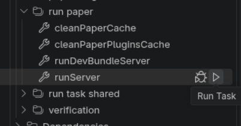

# Comment démarrer le serveur OpenMC en local ?
### **Information** : Ce tutoriel se base sur Visual Studio Code actuellement et a été écrite sur un ordinateur avec un système d'opération Linux. Il se peut que les différentes moyens d'avoir le résultat ne fonctionnent pas. Dans ce cas aller demander sur le [Discord](discord.openmc.fr) si des gens peuvent vous aider.

### Durant ce tutoriel il y aura deux méthodes de fonctionnement : une **simple** (Solution 1) et une **"dur" pour les débutants** (Solution 2). 

### 1ère étape :
**Solution 1:**

Installer l'extension VSCode : [Gradle for Java](https://marketplace.visualstudio.com/items?itemName=vscjava.vscode-gradle)

Extensions optionnelles mais recommandées: [Language Support for Java(TM) by Red Hat](https://marketplace.visualstudio.com/items?itemName=redhat.java); [Extension Pack for Java](https://marketplace.visualstudio.com/items?itemName=vscjava.vscode-java-pack)

**Solution 2:**
Si vous ne voulez pas utiliser une extension, passez à l'étape 2.

### 2ème étape :
**Solution 1:**
Cherchez dans la barre latérale une sorte d'éléphant (ou l'extension Gradle directement si vous connaisez le logo)


Ensuite, aller dans la rubrique Tasks (ou Tâches); puis sur la rubrique Run Paper. Vous verez que quatres options s'offrent à vous.

- cleanPaperCache (permet de supprimer le cache généré **sauf** le cache des plugins)
- cleanPaperPluginsCache (permet de supprimer le cache généré des plugins)
- runDevBundleServer (je sais pas mais apparemment c'est pour lancer un serveur et le tester (pas intéressant dans notre cas))
- runServer (démarrer le serveur)

Le dernier nous intéresse plus particulièrement; il permet de lancer le serveur. Pour donc le démarrer survolez le et cliquez sur Run Task (ou Démarrer la tâche).



**Solution 2:**

Ouvrir un terminal de commande dans la racine du projet et exécuter ceci :

``` ./gradlew runServer ```

Note de ElectroLynx : Je recommande pas car il faudra configurer la version de Java, régler partout des petits problèmes pour que cela fonctionne. Je recommande cette technique donc pour ceux qui souhaitent maîtriser ce qu'ils font.

### 3ème étape
**Solution 1 et 2:**
 Ouvrir Minecraft en 26.3 et se connecter sur le serveur : 
 ``` localhost:25565 ```

 Dès lors vous serez sur votre instance OpenMC en local !

 ## Troubles et bugs au démarrage
| Erreur | Raison | Comment le résoudre |
|---|---|---|
|Unrecognized VM option | Un argument que Java ne reconnaît pas | Aller dans [build.gradle](../build.gradle#L162)
|Cette liste peut être amélioré | Contribuez à celle ci | [Contribuer sur GitHub](https://github.com/ServerOpenMC/Plugin-V2)